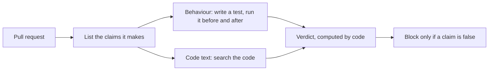
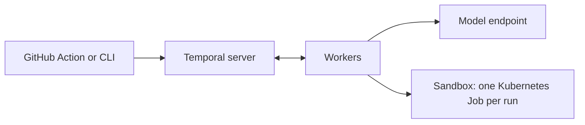

# PR Verification

[](https://github.com/yuchia329/pr-review-agents/actions/workflows/ci.yml)

A CI check that tests what a pull request says about itself.

A pull request's title and description make claims: "fixes the crash on empty input", "renames `URLMatcher` to `URLPattern`". This system lists those claims and checks each one. For a claim about behaviour, it writes a test and runs it on the code before the pull request and after it. For a claim about the code's text, it searches the code. The pull request is blocked only when a claim is shown to be false.

It runs as a GitHub Action or from the command line, and as a durable workflow on Temporal with its sandboxes as Kubernetes Jobs on EKS.

## How it works



Each claim ends **Confirmed**, **Refuted**, or **Inconclusive**.

- **A model does the work, and code makes the decision.** A model lists the claims, writes the tests, and reads the code. Code turns what the tests and searches found into each verdict, and decides whether to block.
- **Untrusted code runs only in a sandbox.** It has no secrets, no network once dependencies are installed, and limits on time, memory, and CPU. It runs as a user that is not root, with every capability dropped. Locally the sandbox is a container. On EKS it is a Kubernetes Job under deny-all network policy.
- **Prompt injection is contained, not detected.** Everything the model reads comes from the pull request's author and is treated as data. The worst a successful injection can do is get a false claim Confirmed. It cannot reach the API key, write to the repository, or overspend the budget.
- **The test writer cannot fit its test to the new code.** It sees the old code in full, and only the function signatures of the new code.
- **Every run has a budget** of time, money, and model requests. A claim still open when the budget is spent is Inconclusive. An agent loop is stopped when it repeats itself or stops making progress.

## How it runs



- **A run survives losing its worker.** Every call that leaves a run is recorded with its answer: model requests, sandbox commands, git commands, clock readings. A new worker replays the same pipeline code against that record and goes on from the first call with no answer. A lost worker costs only the step it was making.
- **It scales out by adding workers.** Temporal holds each run's state, so workers hold none. Each worker caps how much work it takes at once, and the rest of a burst waits in the queue rather than overloading the model endpoint. The model endpoint sets the ceiling on throughput.
- **The infrastructure is code.** [infra/](infra/) is a Terraform stack: a VPC, an EKS cluster, Temporal installed by Helm on RDS PostgreSQL, strict network policy in every namespace, IMDSv2, and a cost budget.

## Results

Two errors matter. A **False Assurance** is a false claim Confirmed: the worst error, since it tells a reviewer to trust something untrue. A **False Block** is a true claim Refuted, which blocks sound work. Inconclusive is the safe answer: it neither blocks nor vouches.

| Question | What was measured | Record |
| --- | --- | --- |
| Can a pull request that lies, and tries to manipulate the system, get a false claim Confirmed? | On cases held out from all tuning, no: 0 False Assurances in 62 false claims, over 36 runs | [Adversarial evaluation](docs/results/adversarial-evaluation.md#the-held-out-part-once-2026-11-02) |
| Does it still confirm true claims? | 21 of 22 true claims Confirmed, and no False Block | [The same run](docs/results/adversarial-evaluation.md#the-held-out-part-once-2026-11-02) |
| Did fixing the failures work? | False Assurances fell from 9 of 99 to 6 of 93, then to 2 of 94, over two changes. Each failure was traced to its cause before the change was made | [Adversarial evaluation](docs/results/adversarial-evaluation.md#after-the-writer-and-judge-change-2026-11-02) |
| Is a multi-agent supervisor better than a fixed pipeline? | No. The same error rate, and 3.4 times slower at the median. The supervising model decided no more claims than a fixed rule in its place. So the system uses the fixed pipeline | [Side by side](docs/results/adversarial-evaluation.md#the-fixed-pipeline-and-the-supervisor-side-by-side-2026-10-18-to-19) |
| Does a run survive losing its worker? | A worker was killed with SIGKILL in the middle of a step in 180 runs. All 180 finished with a report, and no finished step was run twice | [Durability](docs/results/durability-and-eks.md#durability-of-a-run-that-loses-its-worker) |
| Does it run on Kubernetes? | The EKS stack, 46 resources, was built with Terraform and destroyed with nothing left. The sandbox's contract tests passed 33 of 33 as Kubernetes Jobs, and a full run finished with a report | [EKS](docs/results/durability-and-eks.md#the-eks-stack-and-the-kubernetes-sandbox) |
| Does it work on real pull requests? | As a GitHub Action: a true claim Confirmed in 61 seconds, and a breaking change Refuted with the check failed. Five runs cost $0.04 | [Delivery](docs/how-it-works/delivery.md#manual-check-of-the-workflow) |

Each record gives its commit, model, settings, and what it cannot show. All of them are in [docs/](docs/).

## Scope

- **Python repositories.** Other languages plug in behind one interface, and Python is the one built.
- **Slow on a self-hosted model.** On Qwen 3.8 27B, a pull request with false claims took about 41 minutes at the median, and one with true claims about 3 minutes, mostly waiting for the model. Hosted review tools report 30 seconds to 20 minutes.
- **Safe rather than decisive on false claims.** Most false claims end Inconclusive rather than Refuted. Nothing false is vouched for, but a reviewer still checks them.
- **Small samples.** The held-out cases are four pull requests, and each record says how far its numbers can be read.
- **The EKS stack is a two-node experiment.** It was not load tested.

## How it was built

The code was written by coding agents, Claude Code and Cursor, directed by the author. Each piece of work is three branches, merged in order:

1. **Contract:** the public interface, as stubs with docstrings.
2. **Tests:** written from the contract, and reviewed by the author.
3. **Implementation:** the code that makes those tests pass.

While the implementation is written, `tests/` is locked. A hook refuses any edit there ([tools/tests_lock.py](tools/tests_lock.py)). Before the branch merges, a reviewer agent reads its diff for signs of code written to pass the tests rather than to do the job ([.claude/agents/](.claude/agents/)). The rules are in [AGENTS.md](AGENTS.md).

## The repository

```
src/pr_verification/     the system
  core.py                the entry point: a pull request in, a report out
  claims.py              lists the claims
  reproduction.py        writes and runs the tests
  judge.py               checks a test tests what its claim says
  structural.py          checks claims about the code's text
  verdict.py             computes each verdict, with no model
  sandbox.py             the sandbox as a container
  kubernetes_sandbox.py  the sandbox as a Kubernetes Job
  durable/               the Temporal workflows and activities
  supervisor.py          the multi-agent alternative it was measured against
tests/                   pytest and Hypothesis
tools/                   the measurement scripts
evaluation/              evaluation cases, as data
infra/                   Terraform for EKS
docs/                    measurements and configuration
action.yml               the GitHub Action
CONTEXT.md               the vocabulary
```

## Running it

It needs Python 3.12, [uv](https://docs.astral.sh/uv/), and Docker. The model is any OpenAI-compatible endpoint ([docs/how-it-works/model-endpoints.md](docs/how-it-works/model-endpoints.md)).

```sh
uv sync
export PR_VERIFICATION_API_KEY=...
uv run pr-verification --repo path/to/repository --before <commit> --after <commit> \
    --title "Fix the crash on empty input" --description-file description.md
```

It prints the report as JSON. The exit code is 0 when the pull request passes, 1 when it is blocked, and 2 when there is no report.

As a durable run, against a Temporal server:

```sh
uv sync --extra durable
temporal server start-dev
uv run pr-verification-durable worker --state-dir ~/.cache/pr-verification
uv run pr-verification-durable verify --repo path/to/repository --before <commit> --after <commit> \
    --title "Fix the crash on empty input"
```

As a GitHub Action, add one workflow file and one secret: [docs/how-it-works/delivery.md](docs/how-it-works/delivery.md). For EKS, the steps are at the top of [infra/versions.tf](infra/versions.tf).
